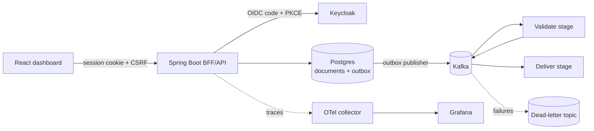

# invoice-relay

A small invoice pipeline built to show how I design reliable backend systems: every invoice is accepted, validated and delivered exactly once in effect, even when Kafka redelivers a message or a service crashes halfway through.

> **Status:** early development. v1 (API, auth, tests, CI, dashboard) is targeted for mid-November 2026, and v2 (Kafka pipeline, tracing, GraphQL, AWS) for mid-December 2026.

## Goal

Answer one question with code and a test: **how do you guarantee an invoice is never sent twice?**

- A transactional outbox, so a write to the database and its event can't drift apart
- Idempotent consumers, so delivering the same event twice changes nothing
- A dead-letter topic with replay, so failures are visible and recoverable
- End-to-end tracing, so you can follow one document from upload to delivery

## Planned architecture

**Document lifecycle:** `received → validated → delivered`, or `failed`, which goes to the dead-letter topic and can be replayed.

**Delivery:** each tenant registers a webhook URL. The deliver stage sends an HTTP POST signed with HMAC-SHA256 and carrying an `Idempotency-Key` header (the document ID). It retries with exponential backoff and sends the document to the dead-letter topic once retries are exhausted.

## Stack

| Layer | Choice |
|---|---|
| Backend | Java 21, Spring Boot 3, modular monolith |
| Data | PostgreSQL, Flyway, keyset pagination, optimistic locking; multi-tenant via a `tenant_id` column with Postgres row-level security |
| Messaging | Kafka, transactional outbox, idempotent consumers, dead-letter topic |
| Auth | Keycloak (OIDC); backend-for-frontend with an HttpOnly session cookie + CSRF; tokens never reach the browser |
| Frontend | React, TypeScript (strict), Vite, Tailwind, TanStack Query |
| API | REST with Problem Details (RFC 9457) errors; GraphQL read API |
| Testing | JUnit 5, Spring test slices, Testcontainers (Postgres, Kafka), Playwright |
| Observability | OpenTelemetry → Grafana |
| Infra | Terraform → AWS ECS Fargate + RDS; GitHub Actions with OIDC (no long-lived keys) |

## Roadmap

**v1: secure, tested API and dashboard**
- [ ] Spring Boot skeleton, Postgres via docker-compose, Flyway, `POST /documents` with validation and Problem Details
- [ ] Keycloak login, BFF with session cookie + CSRF, role and per-tenant authorisation
- [ ] Integration and security tests with Testcontainers; CI on GitHub Actions
- [ ] React dashboard with server-side paging and URL filters; Playwright end-to-end tests

**v2: event-driven pipeline, observable and deployed**
- [ ] Kafka validate/deliver stages with outbox, idempotent consumer, DLT, and a test that delivers the same event twice
- [ ] Signed webhook delivery (HMAC, `Idempotency-Key`, retries with backoff), tested against WireMock
- [ ] Keyset-paginated search with indexes checked via `EXPLAIN`; optimistic locking
- [ ] End-to-end tracing in Grafana; GraphQL read API
- [ ] Terraform deploy to AWS (ECS Fargate + RDS) behind a budget alarm

## Design decisions

Architecture Decision Records will live in [`docs/adr/`](docs/adr/):

- ADR-001: why a modular monolith (not microservices)
- ADR-002: cookie session via BFF vs tokens in the SPA

## Running locally

Coming with the first v1 milestone.
