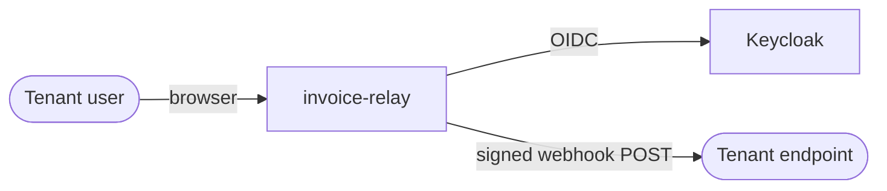
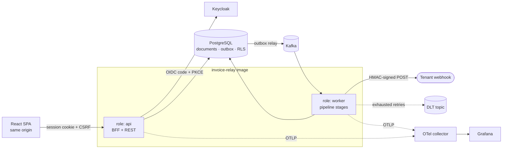
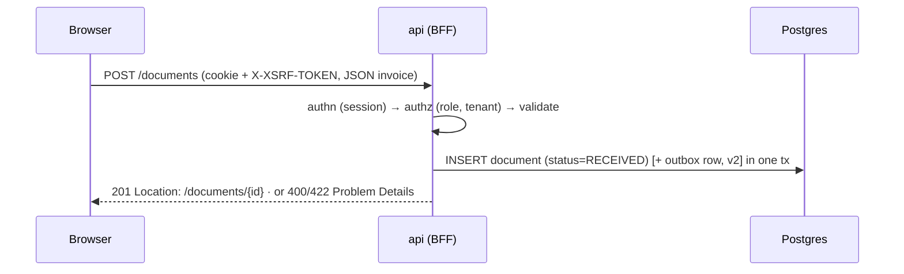
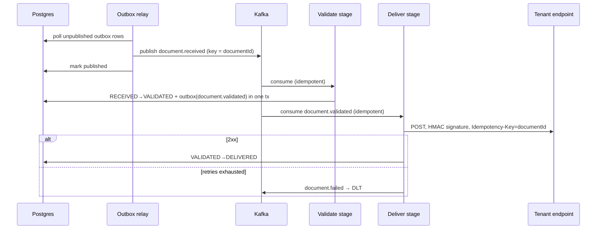

# Architecture

> Living document: it describes what is built, and anything not built yet is marked *(planned)*. Decisions and their reasons live in [ADRs](adr/README.md).

## Goal and quality attributes
The system must make one guarantee: **every accepted invoice is delivered to its tenant's endpoint at most once in effect.** Duplicates may be sent on the wire but are harmless, because the receiver de-duplicates on `Idempotency-Key`, and nothing is lost.

| Attribute | How it is met |
|---|---|
| No lost documents | Transactional outbox: the state change and its event are committed together *(planned)* |
| No duplicate effects | Idempotent consumers + `Idempotency-Key` on delivery *(planned)* |
| Tenant isolation | `tenant_id` on every row, checked in the application layer **and** enforced by Postgres RLS *(planned)* |
| Recoverability | Dead-letter topic with replay *(planned)* |
| Traceability | One trace from upload to delivery across HTTP and Kafka *(planned)* |
| Security | BFF: tokens stay server-side; HttpOnly session cookie + CSRF *(planned)* |

## Context

## Containers

**One codebase, one image, two roles** chosen by Spring profile: `api` serves HTTP and `worker` runs the Kafka stages. Each role scales on its own (ECS services) without splitting into microservices; see ADR-0001.

## Modules
Base package `dev.marioprskalo.invoicerelay`. Each module has `domain/` · `application/` · `infrastructure/` · `web/` (see [conventions](conventions.md#backend)).

| Module | Owns | Talks to | Status |
|---|---|---|---|
| `documents` | Document intake, validation, lifecycle state | `outbox` (events), `tenants` (API) | *(planned, v1)* |
| `tenants` | Tenants, webhook endpoints, signing secrets | — | *(planned, v1)* |
| `delivery` | Delivery attempts, retries, HMAC signing, SSRF guard | `documents` (events) | *(planned, v2)* |
| `outbox` | Outbox table, relay to Kafka | Kafka | *(planned, v2)* |
| `shared` | Tenant context, Problem Details, observability helpers | — | *(planned, v1)* |

`ApplicationModules.verify()` runs as a test and fails the build on boundary violations.

## Key flows

### 1 · Submit a document (v1)

### 2 · Pipeline (v2) *(planned)*

Open design points (decided in the Wk 5 step): hand-written outbox relay vs Spring Modulith's event publication registry; polling vs CDC; how consumer de-duplication is keyed.

### 3 · Login (v1) *(planned)*
Authorization code + PKCE between the BFF and Keycloak. Tokens are stored server-side in the session; the browser only ever holds an HttpOnly, Secure, SameSite session cookie. See ADR-0002.

## Deployment (v2) *(planned)*
Terraform → AWS: ALB (path routing: `/api/*` and `/login/*` → api service, `/*` → static SPA), ECS Fargate services `api` and `worker`, RDS Postgres, Kafka (choice TBD in the Wk 8 step), CloudWatch / Grafana. GitHub Actions authenticates with OIDC, so there are no long-lived keys. A budget alarm is created first.

## Bottlenecks and scaling notes
- **Outbox relay:** one poller is a throughput ceiling and a single point of delay → batch with `FOR UPDATE SKIP LOCKED`; alert on outbox lag.
- **Deliver stage:** slow tenant endpoints hold up consumers → per-call timeouts, bounded concurrency, per-tenant isolation to consider.
- **Kafka partitioning:** key = `documentId` gives per-document ordering; parallelism is capped by the partition count.
- **Postgres:** keyset pagination on `(tenant_id, created_at, id)`; indexes verified with `EXPLAIN` (Wk 6).
