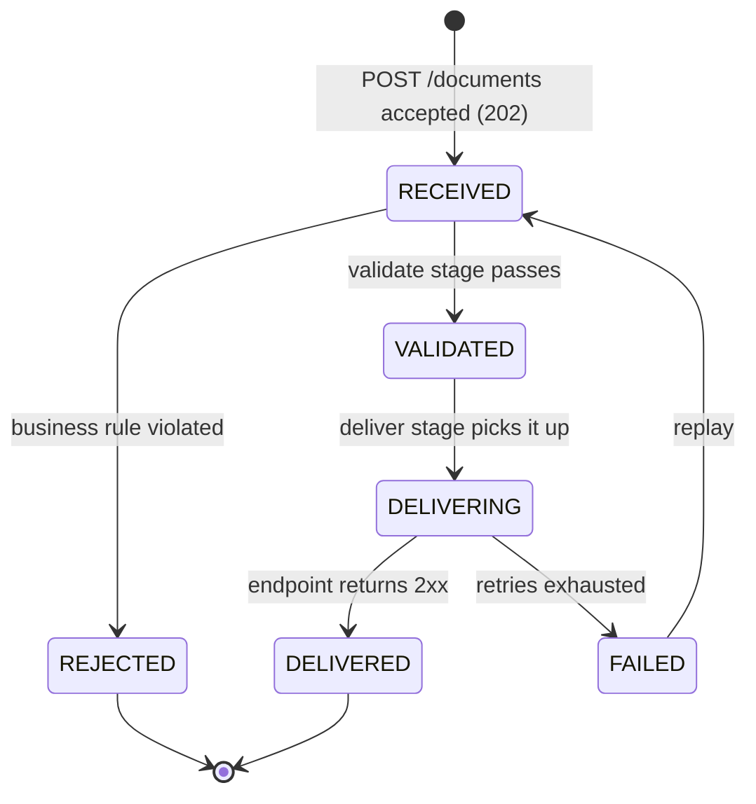

# Domain

> The shared language for code, tests and docs. Names here are the names in code. Decisions marked `TODO(Mario)` are open.

## Glossary
| Term | Meaning |
|---|---|
| **Tenant** | A customer organisation. Every row and every request belongs to exactly one tenant. |
| **Document** | One submitted invoice plus its lifecycle state. v1 payload: a structured JSON invoice. |
| **Invoice** | The business content of a document: parties, lines, VAT breakdown, totals, currency. |
| **Seller** | The party issuing the invoice, identified by its VAT ID. One tenant can submit invoices for several sellers. |
| **Line item** | One billed item: description, quantity, unit price, VAT rate, line net amount. |
| **Violation** | One broken rule on a document: `field` (JSON path), `code` (stable, machine-readable) and `message` (what to change). |
| **Endpoint** | A tenant's registered webhook URL plus its signing secret. |
| **Delivery attempt** | One HTTP POST of a document to an endpoint, with its outcome. *(v2)* |
| **Outbox record** | An event row written in the same transaction as a state change and relayed to Kafka. *(v2)* |
| **Dead letter** | A document whose delivery failed after all retries (`FAILED`). It can be replayed. *(v2)* |

## Lifecycle


| State | Meaning | Terminal | Stored with it |
|---|---|---|---|
| `RECEIVED` | Passed intake checks and stored; waiting for validation | no | — |
| `VALIDATED` | All business rules pass | no | — |
| `REJECTED` | A business rule failed. The client must fix the invoice and submit a **new** document; we never edit client data | yes | ≥ 1 violation |
| `DELIVERING` | The deliver stage owns it; covers the whole retry sequence | no | `deliveringSince`, attempt records |
| `DELIVERED` | The endpoint returned 2xx | yes | last attempt |
| `FAILED` | All delivery retries exhausted | no (replay) | last attempt outcome, attempt count, time |

**Rules**
- **Intake rejects synchronously.** A request that fails an intake check (see [Intake](#intake)) gets a 4xx and is never stored, so it never enters the lifecycle.
- **Replay re-runs the whole pipeline.** `FAILED → RECEIVED` re-checks every rule against the *current* rules. A replayed document can therefore end up `REJECTED` if the rules changed in the meantime. `REJECTED` documents are never replayed.
- **`DELIVERING` has a lease.** If a worker crashes mid-delivery, the document would stay `DELIVERING` forever. A sweeper re-queues any document whose `deliveringSince` is older than the lease (5 min). Re-sending is safe because the receiver de-duplicates on the delivery `Idempotency-Key` (see [Idempotency](#idempotency)). *(v2)*
- **Manual re-send** of a `DELIVERED` document does not change its state. It is an audited delivery attempt (`trigger = MANUAL`) with the same `Idempotency-Key`, so a receiver that already has the document drops it, and "never delivered twice" still holds. It exists for receivers that lost the document. *(planned, v2)*

**Failure details**
- `REJECTED`: violations are stored on the document as `[{ field, code, message }]`, e.g. `{ "field": "lines[2].netAmount", "code": "LINE_NET_MISMATCH", "message": "must equal round(quantity × unitPrice, 2, HALF_UP) = 0.50" }`. The API returns them as Problem Details `errors[]`.
- `FAILED`: the last attempt's outcome (HTTP status, or an error class such as `TIMEOUT` / `CONNECTION_REFUSED`), the attempt count and the time. The receiver's response body is never stored or logged; at most a truncated, sanitised summary.
- Logs carry only `documentId` and violation `code`s or the error class, never field values (see [conventions](conventions.md#backend)).

## Intake
`POST /documents` runs **structural** checks synchronously. **Business** rules run in the async validate stage, so `REJECTED` is a real, observable path.

| Check | Where | Result on failure |
|---|---|---|
| Body over 1 MiB (checked before parsing) | intake | `413` |
| `Content-Type` not `application/json` | intake | `415` |
| Malformed JSON | intake | `400` |
| Schema: required fields, types, lengths, number formats, ISO 4217 / 3166 codes, decimal places, limits | intake | `422` + `errors[]` |
| Duplicate invoice number (invariant 3) | intake | `409` + existing document ID |
| Arithmetic: line nets, VAT breakdown, totals | validate stage | `REJECTED` + violations |
| External checks, e.g. VIES VAT ID lookup | validate stage | `REJECTED` *(planned; adds an outbound call to the threat model when built)* |

On success: `202 Accepted` + `Location: /documents/{id}`; the body holds the document ID and state. All errors are Problem Details (RFC 9457).

## Invoice shape (v1)
A small subset of the EU e-invoicing semantic model **EN 16931**. Fields are added when a real need appears.

```json
{
  "invoiceNumber": "INV-2026-0042",
  "issueDate": "2026-10-29",
  "dueDate": "2026-11-28",
  "currency": "EUR",
  "seller": {
    "name": "Acme d.o.o.",
    "vatId": "HR12345678901",
    "address": { "street": "Ilica 1", "city": "Zagreb", "postalCode": "10000", "countryCode": "HR" }
  },
  "buyer": {
    "name": "Example GmbH",
    "vatId": "ATU12345678",
    "address": { "street": "Ring 2", "city": "Wien", "postalCode": "1010", "countryCode": "AT" }
  },
  "lines": [
    { "description": "Consulting", "quantity": "1.5", "unitPrice": "0.33", "vatRate": "25.00", "netAmount": "0.50" }
  ],
  "vatBreakdown": [
    { "vatRate": "25.00", "taxableAmount": "0.50", "taxAmount": "0.13" }
  ],
  "totals": { "netTotal": "0.50", "taxTotal": "0.13", "grossTotal": "0.63" }
}
```

| Field | Required | Notes |
|---|---|---|
| `invoiceNumber` | yes | ≤ 50 chars |
| `issueDate`, `dueDate` | issue: yes · due: no | ISO 8601 date |
| `currency` | yes | ISO 4217 |
| `seller.name`, `seller.vatId`, `seller.address` | yes | `vatId` is part of the uniqueness key (invariant 3) |
| `buyer.name`, `buyer.address` | yes | `buyer.vatId` optional |
| `address.countryCode` | yes | ISO 3166-1 alpha-2 |
| `lines[]` | yes, 1–500 | `description` ≤ 500 chars |
| `lines[].vatRate`, `vatBreakdown[].vatRate` | yes | percent, e.g. `"25.00"` |
| `vatBreakdown[]` | yes | one entry per distinct `vatRate` |
| `totals` | yes | sent by the client, verified by us |

**Money and quantities are decimal strings** (`"12.50"`), mapped to `BigDecimal`. JSON numbers lose precision in clients that parse them as doubles (JavaScript), and minor units can't express unit prices like `"0.0125"`.

## Invariants
Each is a rule the domain enforces, with the test that proves it. Tests are *(planned)* until the step that builds them.

| # | Invariant | Checked at | Test |
|---|---|---|---|
| 1 | **Totals add up.** We never change the client's numbers; we verify them against a documented rule: `lineNet = round(quantity × unitPrice, scale, HALF_UP)`; each breakdown `taxableAmount` = sum of `netAmount` for its rate; `taxAmount = round(taxableAmount × vatRate / 100, scale, HALF_UP)`; `netTotal` = Σ `netAmount`, `taxTotal` = Σ `taxAmount`, `grossTotal = netTotal + taxTotal`, all exact | validate | `1.5 × 0.33` with `netAmount "0.50"` passes, `"0.49"` is rejected; each total off by 0.01 is rejected |
| 2 | **One currency per invoice**, ISO 4217. Every amount has exactly the currency's minor-unit digits (`scale` = `Currency.getDefaultFractionDigits()`: EUR 2, JPY 0, KWD 3). Amounts are never floating point | intake | `"12.5"` in EUR → 422; `"1250"` in JPY passes; unknown code → 422 |
| 3 | **Invoice number unique per tenant + seller** (`tenant_id`, `seller.vatId`, `invoiceNumber`). `REJECTED` documents don't count, so a corrected resubmission can reuse the number (partial unique index `WHERE status <> 'REJECTED'`). A duplicate returns `409` with the existing document's ID | intake | Second submit → 409; resubmit after `REJECTED` → 202; same number for another seller → 202 |
| 4 | **A document's tenant never changes.** `tenantId` comes from the session, never from the request body; the column is not updatable; the RLS `WITH CHECK` policy rejects any change | always | Body `tenantId` is ignored; an `UPDATE` of `tenant_id` fails under RLS |
| 5 | **Transitions only along the [lifecycle](#lifecycle).** `REJECTED` and `DELIVERED` are terminal | domain | Every illegal transition throws |
| 6 | **Limits:** body ≤ 1 MiB, 1–500 lines, `invoiceNumber` ≤ 50 chars, `description` ≤ 500 chars | intake | 1 MiB + 1 byte → 413; 501 lines → 422 |
| 7 | **Every failure says why.** A `REJECTED` document has ≥ 1 violation; a `FAILED` document has its last attempt outcome | domain | `REJECTED` with no violations can't be constructed |

## Idempotency
- **Intake:** `POST /documents` accepts an optional `Idempotency-Key` header, scoped per tenant and kept for **3 days**.
  - Same key, same body → the original `202` + `Location` is returned again; nothing new is stored.
  - Same key, different body → `422` (a client bug).
  - Same key while the first request is still in flight → `409`.
- **Why both a key and invariant 3:** the key catches a *retry of the same request* and replays the exact response. Invoice-number uniqueness catches *the same invoice in a new request* (no key, a new key, or a key past its 3 days) and is the backstop.
- **Pipeline:** TODO(Mario): the de-duplication key per consumer (event ID vs document ID + stage). *(Wk 5)*
- **Delivery:** `Idempotency-Key` = document ID (decided). Receivers de-duplicate on it, which is what makes `DELIVERING` lease recovery and manual re-send safe.
