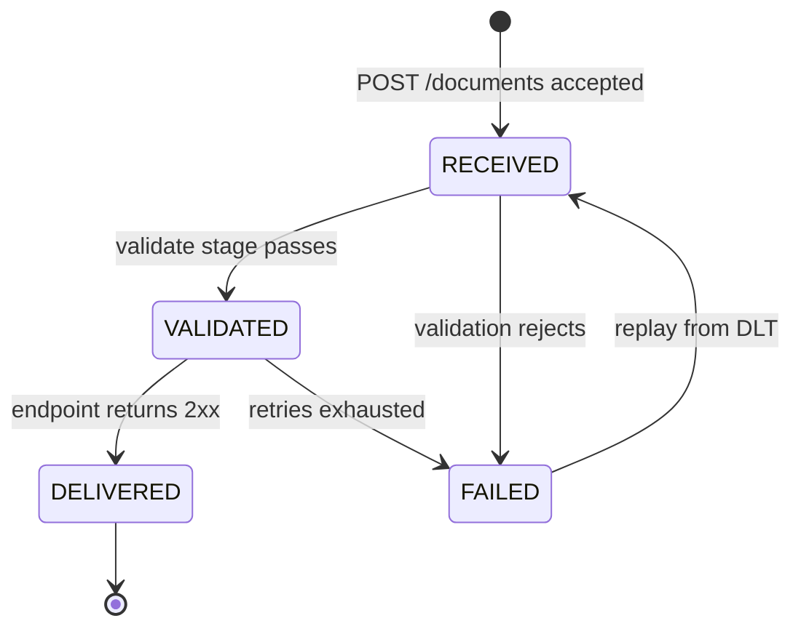

# Domain

> The shared language for code, tests and docs. Names here are the names in code. Decisions marked `TODO(Mario)` are open.

## Glossary
| Term | Meaning |
|---|---|
| **Tenant** | A customer organisation. Every row and every request belongs to exactly one tenant. |
| **Document** | One submitted invoice plus its lifecycle state. v1 payload: a structured JSON invoice. |
| **Invoice** | The business content of a document: parties, lines, totals, currency. |
| **Line item** | One billed item: description, quantity, unit price, tax rate, line total. |
| **Endpoint** | A tenant's registered webhook URL plus its signing secret. |
| **Delivery attempt** | One HTTP POST of a document to an endpoint, with its outcome. *(v2)* |
| **Outbox record** | An event row written in the same transaction as a state change and relayed to Kafka. *(v2)* |
| **Dead letter** | A document whose processing or delivery failed permanently; it can be replayed. *(v2)* |

## Lifecycle

TODO(Mario): confirm the states and transitions, including whether replay goes back to `RECEIVED` or to the stage that failed. Also decide whether intake checks (schema, sizes) reject synchronously with 400/422, so the document is never stored, while the validate stage only checks business rules.

## Invoice shape (v1)
TODO(Mario): define the JSON fields. A useful reference is the EU e-invoicing semantic model **EN 16931** (seller, buyer, invoice number, issue date, currency, lines, VAT breakdown, totals). Pick a small subset you can defend; don't model the whole standard.

## Invariants
Write each as a rule the domain enforces, with the test that proves it. TODO(Mario): decide which apply and how strictly.

| # | Candidate invariant | Decide | Test |
|---|---|---|---|
| 1 | Invoice total = sum of line totals + tax, with explicit rounding rules | TODO(Mario) | |
| 2 | One currency per invoice (ISO 4217); amounts never float | TODO(Mario) | |
| 3 | Invoice number unique per tenant (+ seller?) → what does a duplicate submit return? | TODO(Mario) | |
| 4 | A document's tenant never changes | TODO(Mario) | |
| 5 | State transitions only along the lifecycle above; `DELIVERED` is terminal | TODO(Mario) | |
| 6 | Limits: max lines, max payload size | TODO(Mario) | |

## Idempotency
- **Intake:** TODO(Mario): does `POST /documents` accept an `Idempotency-Key` from the client? If so, store key → response for a defined TTL, scoped per tenant.
- **Pipeline:** TODO(Mario): the de-duplication key per consumer (event ID vs document ID + stage). *(Wk 5)*
- **Delivery:** `Idempotency-Key` = document ID (decided). Receivers de-duplicate on it.
