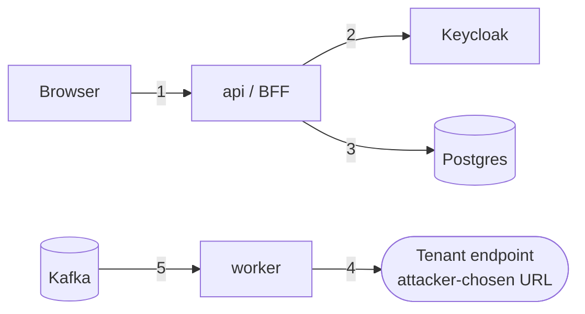

# Threat model

> STRIDE-lite, updated whenever a trust boundary or outbound call is added. Status: ⏳ planned · 🔧 in progress · ✅ implemented and tested.

## Assets
Invoice contents (commercial data, possibly personal data) · tenant webhook signing secrets · user sessions · document state (a forged `DELIVERED` hides a loss).

## Trust boundaries

1 internet → app · 2 app → IdP · 3 app → DB · 4 app → **arbitrary external URL** · 5 broker → consumer

## Threats
| # | Threat | Boundary | Mitigation | Test | Status |
|---|---|---|---|---|---|
| T1 | Cross-tenant read or write (IDOR) | 1, 3 | Tenant taken from the session, never from the request; scoped queries + Postgres RLS; 404 for other tenants | 404 for another tenant's ID | ⏳ |
| T2 | Token theft via XSS | 1 | BFF: tokens stay server-side; HttpOnly, Secure, SameSite cookie; CSP | No token in any browser-visible response | ⏳ |
| T3 | CSRF on cookie-authenticated endpoints | 1 | Spring Security CSRF (SPA mode, `XSRF-TOKEN` cookie + header) | 403 without the token | ⏳ |
| T4 | Session fixation / hijack | 1 | New session ID on login; idle + absolute timeouts; logout invalidates the session server-side and at the IdP | Session ID changes on login | ⏳ |
| T5 | Privilege escalation | 1 | Roles mapped from Keycloak, checked per endpoint/method | 403 for the wrong role | ⏳ |
| T6 | **SSRF via tenant webhook URL** | 4 | HTTPS only; reject private, loopback, link-local and metadata ranges (incl. `169.254.169.254`) **after** DNS resolution, and pin the connection to the checked IP (prevents DNS rebinding); no redirects; timeouts. Spring Boot 4.1's `InetAddressFilter` is the candidate hook (Wk 5–6 step) | WireMock + blocked-address cases | ⏳ |
| T7 | Forged or replayed webhook | 4 | HMAC-SHA256 over `timestamp + "." + body`; the timestamp header lets receivers reject old messages; secret per endpoint, rotatable | Signature test vectors | ⏳ |
| T8 | Duplicate delivery on redelivery or crash | 5 | Idempotent consumer + `Idempotency-Key` | Same event delivered twice → one effect | ⏳ |
| T9 | Poison message blocks a partition | 5 | Bounded retries → DLT; replay tooling | Malformed event lands on the DLT | ⏳ |
| T10 | Denial of service via large or many requests | 1 | Body size limit, line-item limit, rate limit per tenant | 413 / 429 tests | ⏳ |
| T11 | Sensitive data in logs or traces | all | No bodies, tokens or secrets logged; attributes allow-listed in spans | Log-capture test | ⏳ |
| T12 | Secrets leaked from the repo or CI | — | No secrets in git; GitHub OIDC → AWS (no long-lived keys); secret scanning | — | ⏳ |
| T13 | Supply chain | — | Dependabot; GitHub Actions pinned to commit SHAs; minimal base image | — | ⏳ |

TODO(Mario): review each row when its step lands, and add threats found during the step.
